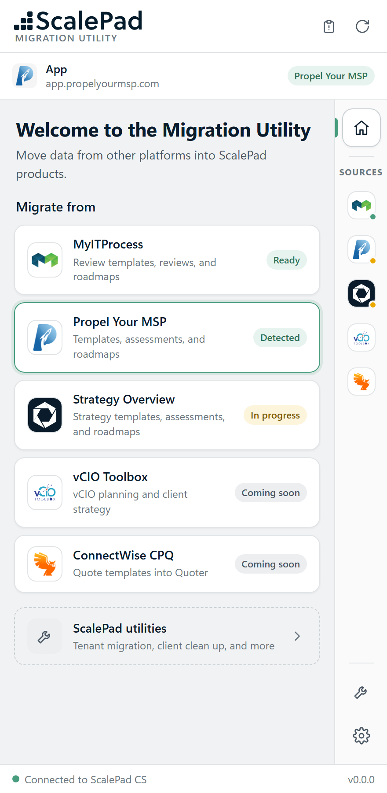
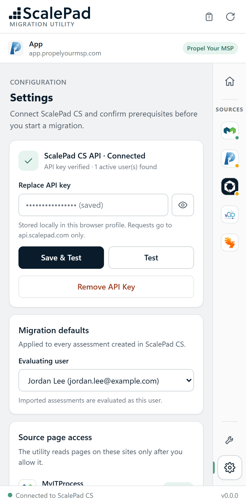
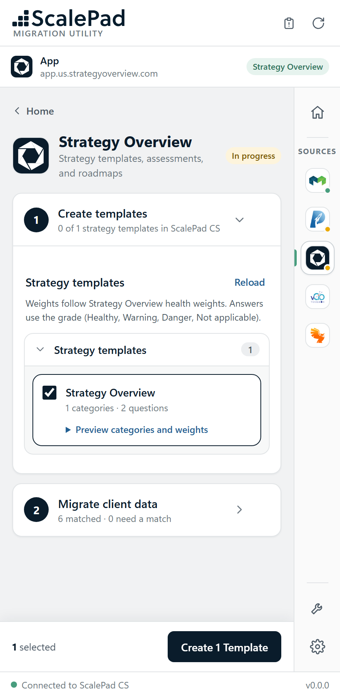
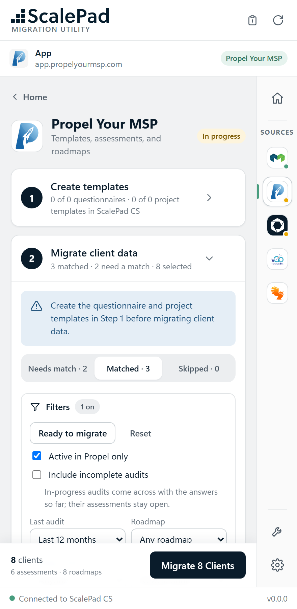
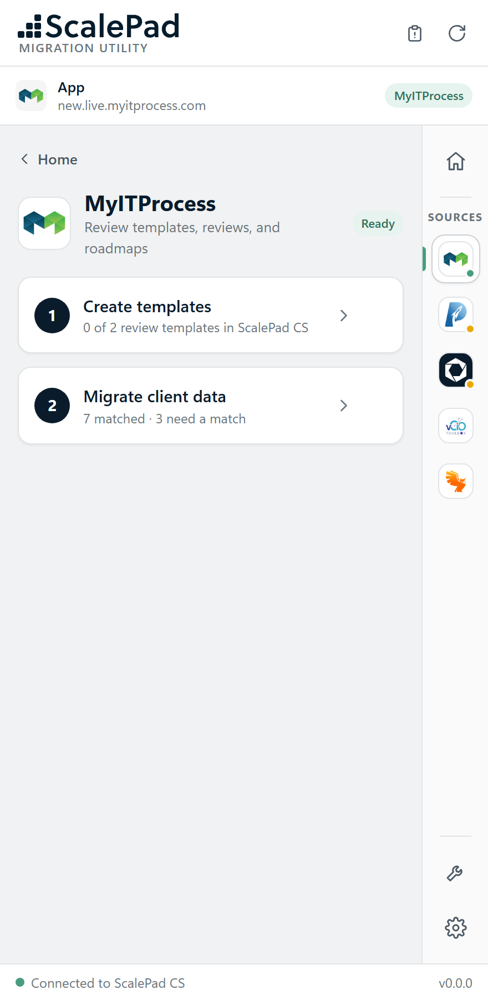
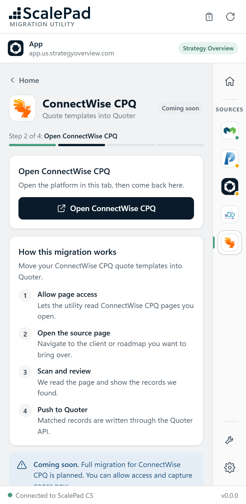
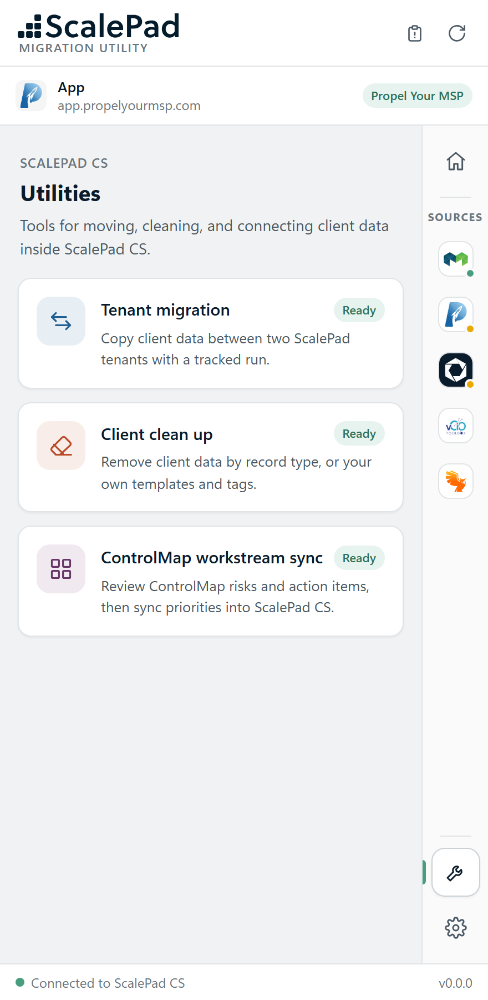
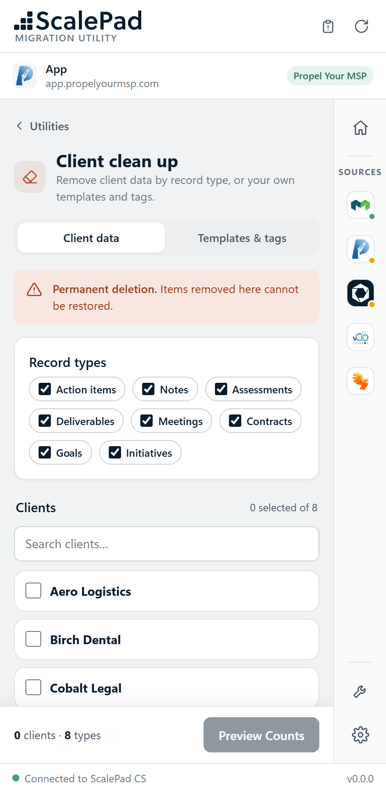
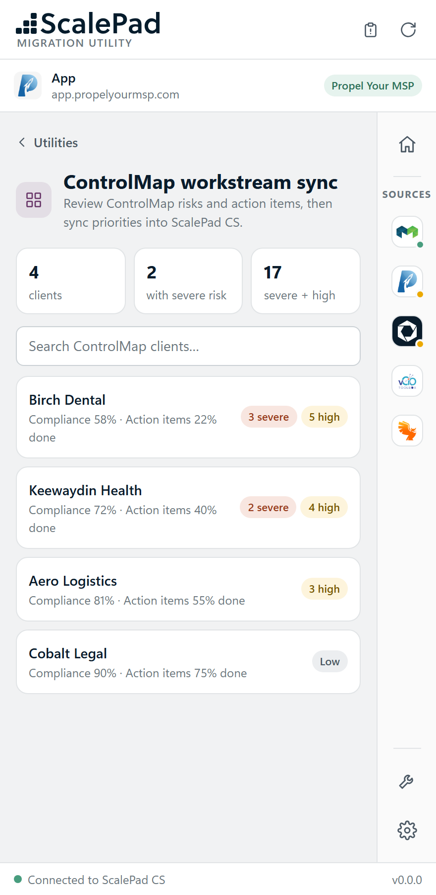
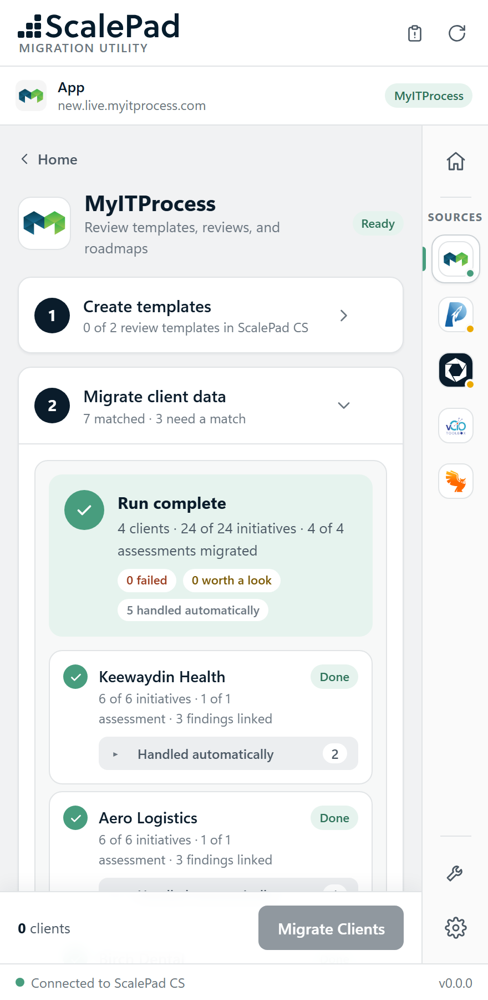

<p align="center">
  <picture>
    <source media="(prefers-color-scheme: dark)" srcset="extension/icons/scalepad-logo-white.svg">
    
  </picture>
</p>

<h1 align="center">ScalePad Migration Utility</h1>

<p align="center">
  A Chrome side panel that moves your data from other platforms into ScalePad, with no exports and no spreadsheets.
</p>

<p align="center">
  
</p>

---

## Contents

- [What it does](#what-it-does)
- [Download and install](#download-and-install)
- [First-time setup](#first-time-setup)
- [How every migration works](#how-every-migration-works)
- [How-to guides by source](#how-to-guides-by-source)
  - [Propel Your MSP](#propel-your-msp)
  - [MyITProcess](#myitprocess)
  - [Strategy Overview](#strategy-overview)
  - [Coming soon: vCIO Toolbox and ConnectWise CPQ](#coming-soon)
- [ScalePad utilities](#scalepad-utilities)
- [Checking results and fixing issues](#checking-results-and-fixing-issues)
- [Privacy and security](#privacy-and-security)
- [Troubleshooting](#troubleshooting)
- [For developers](#for-developers)

---

## What it does

The Migration Utility lives in Chrome's side panel. You sign in to the tool you use today, open the panel, and it copies your templates, assessments and roadmaps into ScalePad.

| Migrate from | Moves into | What comes across | Status |
| --- | --- | --- | --- |
| **Propel Your MSP** | ScalePad CS | Questionnaires, project templates, audits, roadmaps | ✅ Available |
| **MyITProcess** | ScalePad CS | Review templates, Alignment reviews, Strategy recommendations | ✅ Available |
| **Strategy Overview** | ScalePad CS | Strategy templates, report assessments, IT Plan, Initiatives | ✅ Available |
| **vCIO Toolbox** | ScalePad CS | Planning and client strategy | 🕒 Coming soon |
| **ConnectWise CPQ** | Quoter | Quote templates | 🕒 Coming soon |

It also includes three **ScalePad utilities**: Tenant migration, Client clean up and ControlMap workstream sync.

**Why it's different**

- **Nothing to export.** It reads your data through the app you're already signed in to, right in the browser.
- **Safe to run again.** It remembers what it already moved, so a second run fixes gaps instead of creating duplicates.
- **Clear results.** Every run ends with a plain-language summary of what moved and what needs a look.

---

## Download and install

You need **Google Chrome** (or Microsoft Edge) on a computer. Installing takes about two minutes.

### 1. Download

On this GitHub page, click the green **Code** button, then **Download ZIP**. Unzip it somewhere you'll keep it, such as your Documents folder.

> Prefer Git? Run `git clone https://github.com/tulsie-narine/ScalePad-Migration-Utility.git`.

### 2. Load it into Chrome

1. Open a new tab and go to `chrome://extensions` (in Edge: `edge://extensions`).
2. Turn on **Developer mode** (top-right switch).
3. Click **Load unpacked**.
4. Select the **`extension`** folder inside the folder you unzipped. Select the `extension` folder itself, not the folder above it.

The **ScalePad Migration Utility** now appears in your extensions list.

### 3. Pin it and open it

1. Click the puzzle-piece icon in Chrome's toolbar and pin **ScalePad Migration Utility**.
2. Click the ScalePad icon. The utility opens in the side panel on the right.

> **Updating:** download the newest ZIP, replace your folder, then click the circular **Reload** arrow on the extension in `chrome://extensions`.

---

## First-time setup



Open **Settings** (the gear at the bottom of the side rail).

1. **Connect ScalePad CS.** Paste your ScalePad API key and click **Save & Test**. A green tick confirms the connection.
   - Don't have a key? An account admin can create one in ScalePad. It needs read and write access to Lifecycle Manager (ScalePad CS).
   - The key is stored only in this browser and is sent only to `api.scalepad.com`.
2. **Choose the evaluating user.** Assessments created during a migration are recorded as evaluated by this person, unless the tool finds a matching owner for them (see below).
3. **Allow source access.** The first time you open a source, Chrome asks before the utility can read that site. Nothing in the source app is ever changed.

<br clear="right">

---

## How every migration works

Every source uses the same two steps.



### Step 1: Create templates

The utility reads the templates from your current tool and shows them in a list. Tick the ones you want and click **Create Templates**.

- Each one becomes an **assessment template** in ScalePad CS, with the same categories and questions.
- Weights carry across where the source has them.
- Templates that already exist in ScalePad CS are marked **In ScalePad CS** and skipped.
- Missing a template later? Step 2 builds it automatically from the assessment it needs.

<br clear="right">



### Step 2: Migrate client data

1. Click **Load** to read your clients and ScalePad CS clients. They're **matched automatically** by name, or by ConnectWise ID for Propel.
2. For any client marked **Needs match**, type in its **Search ScalePad CS clients…** box and click the right one, or choose **Skip — don't migrate**. Use **Change** to correct an automatic match.
3. Use **Filters** to narrow the list:
   - **Ready to migrate:** active clients assessed in the last 12 months that have a roadmap.
   - **Last audit / review:** any time, the last 3, 6 or 12 months, or never.
   - **Roadmap:** has items or empty. Click **Count roadmap items** for exact counts.
   - **Strategic Advisor:** show only one vCIO's clients.
   - **Include incomplete** audits or reviews. These come across with the answers so far and stay open in ScalePad CS.
4. Tick **Assessments** and/or **Roadmap** for each client (or **Select all**) and click **Migrate**.

<br clear="right">

**What comes across**

| From your current tool | Becomes in ScalePad CS |
| --- | --- |
| Audit, review or report | An **assessment** with every answer, comments as internal notes, and a summary of who did it and when |
| Roadmap project, recommendation or plan item | An **initiative** with status, priority, budget, recurring costs and schedule |
| A finding linked to roadmap work | The assessment question **linked** to that initiative |
| Strategic Advisor / vCIO | The initiative **owner**, when a matching ScalePad user exists (otherwise the evaluating user from Settings) |

---

## How-to guides by source

<a id="propel-your-msp"></a>
### Propel Your MSP

1. Sign in to Propel at `app.propelyourmsp.com` in the current tab.
2. Open the utility and click **Propel Your MSP**. Allow access when Chrome asks.
3. **Step 1:** the Questionnaires tab lists your Production questionnaires first. Tick and create. The Project templates tab turns project templates into **initiative templates**, including costs, recurring agreements and business value.
4. **Step 2:** load companies, match them, filter and migrate.

**Good to know**

- Pass / Fail / N/A answers map to Satisfactory / At risk / Not applicable.
- Question weights follow Propel's points.
- Choose the audit range per client: latest per questionnaire, the last 1 to 12 months, or all.
- A failed question linked to a Propel project is linked to the migrated initiative.

<a id="myitprocess"></a>
### MyITProcess



1. Sign in to MyITProcess at `new.live.myitprocess.com`. Any page works.
2. Open the utility and click **MyITProcess**.
3. **Step 1:** your **review templates** are found automatically (a template is the set of standards sections a review uses). Tick and create.
4. **Step 2:** load clients, match, filter and migrate. Reviews become assessments; Strategy **recommendations** become initiatives.

**Answer mapping**

| MyITProcess vCIO rating | ScalePad CS answer |
| --- | --- |
| Aligned | Satisfactory |
| Marginal | Needs attention |
| Vulnerable | At risk |
| N/A | Not applicable |

When a question has no vCIO rating, the engineer's Yes / No / N/A is used. Engineer and vCIO comments are kept as internal notes.

<br clear="right">

<a id="strategy-overview"></a>
### Strategy Overview

1. Sign in to Strategy Overview at `app.us.strategyoverview.com`.
2. Open the utility, click **Strategy Overview** and allow access. Then **reload the Strategy Overview tab once** so the utility can see your session.
3. **Step 1:** your **strategy templates** are built from the newest report that uses each one. Health weights carry across.
4. **Step 2:** load companies, match and migrate. Each report becomes an assessment. The roadmap includes the latest report's **IT Plan** items and your **Initiatives**.

**Grade mapping**

| Strategy Overview grade | ScalePad CS answer |
| --- | --- |
| Healthy | Satisfactory |
| Warning | Needs attention |
| Danger | At risk |
| Not Applicable | Not applicable |
| In Progress | Satisfactory when green, otherwise Needs attention |
| Question / Hidden | Left unanswered |

IT Plan items are scheduled from their dates, budget month, or Year › Quarter position. Placeholder years like "202X" stay unscheduled.

<a id="coming-soon"></a>
### Coming soon: vCIO Toolbox and ConnectWise CPQ



Both appear in the panel with a **Coming soon** badge.

- **vCIO Toolbox → ScalePad CS:** planning and client strategy.
- **ConnectWise CPQ → Quoter:** your CPQ **quote templates** moved into Quoter.

Their pages show how the migration will work. The full migration isn't built yet.

<br clear="right">

---

## ScalePad utilities



Open them from **ScalePad utilities** on the home screen, or the wrench in the side rail.

### Tenant migration

Copies a ScalePad tenant's setup and client data into another tenant.

| Copied | What comes with it |
|---|---|
| **Account setup** (once per run) | Tags, custom initiative statuses and labels, goal outcomes, meeting types, and your own meeting, task, initiative, goal, roadmap, agreement and deliverable templates. Anything that already exists with the same name is reused. |
| **Client data** | Initiatives (budget, schedule, status, owner), goals, notes, assessments, meetings (attendees, completion), tasks (assignees, completion, pin), manual agreements and their line items, deliverables rebuilt from their template, client tags |
| **Links** | Goal → initiative; meeting → initiative, goal and note; task → initiative, goal and meeting; initiative tags, external links, files and linked assessment findings |

Not copied: clients, contacts, users, hardware, PSA-synced agreements, tickets and quotes. These come from each tenant's own integrations, and the utility matches against them instead.

1. Paste the **source tenant's API key**. It's kept only for this browser session.
2. Choose the account setup and client data to copy, then pick each source client and its destination client.
3. Check the user matching. Owners, assignees, creators and evaluators are matched by email, then by name; the **default assigned user** covers anyone without a match.
4. Run. Items already copied are remembered and skipped next time.

<br clear="right">

### Client clean up



Removes data you no longer want. Handy after a test migration.

- **Client data:** choose record types (action items, notes, assessments, initiatives and more) and clients, then **Preview Counts** to see exactly what would be removed.
- **Templates & tags:** remove your own assessment, initiative, roadmap, goal, task, deliverable or agreement templates and tags. ScalePad's built-in templates are never listed.
- ⚠️ **Deletion is permanent.** You must tick the acknowledgement and type `DELETE` to confirm.

<br clear="right">

### ControlMap workstream sync



Turns ControlMap **risks** and **action items** into ScalePad CS initiatives, so security work sits on the client's roadmap.

1. Pick a ControlMap client. Clients with severe and high risks are listed first.
2. Confirm the matching ScalePad CS client (usually matched automatically).
3. Choose a schedule for items without dates (3, 6 or 12 months out), select items and sync.
4. Run it again any time. Changed items are updated, and nothing is duplicated.

<br clear="right">

---

## Checking results and fixing issues



When a run finishes you'll see a **summary card**:

- ✅ **Migrated:** counts of initiatives and assessments created.
- **Worth a look:** things to check, such as answers with no matching question.
- **Handled automatically:** small adjustments the tool made for you, such as shortening very long text or moving very old dates into range.
- **Failed:** anything that couldn't be written, with the reason.

Every item is also collected in the **Migration issues** centre (the clipboard icon at the top). Click an item to jump straight back to where it happened.

**Re-running is safe.** Run the same client again and the utility skips what's already there and only repairs what had problems.

**Running from more than one computer.** The record of what's been migrated is kept in the browser you ran it from. Starting a run on a second computer, in another Chrome profile, or after reinstalling the extension doesn't duplicate anything: before creating an assessment or initiative, the utility checks ScalePad CS for a copy an earlier run already made and updates that instead. The run summary says when this happens. To skip the check (and the time it takes), open **Settings › Migration record**, **Export record** on the first computer and **Import record** on the second.

<br clear="right">

---

## Privacy and security

- **Your source-app password is never seen or stored.** The utility works inside your own signed-in browser tab, and the session stays in that page.
- **The ScalePad API key** is stored only in this browser profile and is sent only to `api.scalepad.com`.
- **Source apps are read-only.** Nothing in Propel, MyITProcess or Strategy Overview is changed.
- **Site access is opt-in.** Chrome asks before the utility can read each site, and you can remove access any time in `chrome://extensions`.

---

## Troubleshooting

| Problem | Fix |
| --- | --- |
| "Open … in this tab first" | Switch to a tab where you're signed in to that tool, then try again. |
| "Your session needs refreshing" | Reload the source app's tab (the utility often does this for you), then try again. |
| Strategy Overview shows no data | Reload the Strategy Overview tab once after allowing access. |
| A client isn't matched | Search for it in the client's row and click it, or choose **Skip — don't migrate**. Your choice is remembered. |
| "Worth a look: answers without a matching question" | The template changed since the audit was taken. The unmatched answers are listed in the assessment's notes. |
| Something failed | Open **Migration issues** and read the reason. Fix it, then click **Retry Clients** in the run summary. Only the problem items are redone. |
| I want to undo a test run | Use **Client clean up** on that client. |

---

## For developers

```text
extension/
├── manifest.json               Chrome extension manifest (MV3)
├── icons/                      Extension and brand icons
└── src/
    ├── sidepanel.html|css|js   Side panel: sources, shared migration engine, utilities
    ├── sources.js              Source and utility catalogue (add new sources here)
    ├── propel.js               Propel adapter and shared mapping/planning helpers
    ├── myitp.js                MyITProcess adapter
    ├── so.js                   Strategy Overview adapter
    ├── so-auth-hook.js         Strategy Overview session hook (page world)
    ├── background.js           ScalePad API calls, migration writes, ledgers, utilities
    └── sidepanel-context.js    Active-page context capture
docs/images/                    Screenshots used in this README
```

**How sources plug in:** each source adapter runs inside the signed-in tab, reads that app's own data API, and returns records in one shared shape. Template creation, client matching, filters, the migration ledger, outcome summaries and the issues centre are shared by every source.

**Quick checks**

```bash
node --check extension/src/background.js
node --check extension/src/sidepanel.js
node --check extension/src/propel.js
node --check extension/src/myitp.js
node --check extension/src/so.js
```
